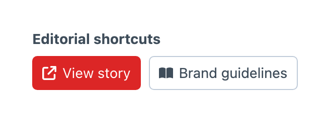

# Action Links

Action Links is a reusable field for editor shortcuts. Create a **Button Box - Action Links** field under **Settings → Fields**, configure its actions, then add it to the layouts that need those links. Editing the field updates every placement.

## Configuring Actions

The Actions table keeps each link’s label, URL, visual and button style together. Enter `/admin/my-page`, `/my-page` or a full URL such as `https://example.com/my-page`. Paths beginning with `/` use the current domain, so use a full URL when your control panel and public site use different domains. Use your configured admin path if it differs from `/admin`. Browse icons and images from the galleries, including your [configured custom folders](../get-started/configuration.md#gallery-folders).

Use **Choose asset…** beside an image visual to search Craft’s asset library. The selected image must have a public URL. Button Box stores the URL, so update the action if that URL changes. Configured custom images remain available through the image gallery.

Open **Edit action…** from the row menu to place the icon or image before or after its label, set image alternative text or open the link in a new window. Reorder, insert and delete actions through the table’s row controls.

Object-template expressions in labels and URLs resolve against the current element when Craft renders the edit form. For example, use `Preview {title}` as a label and `/preview?entryId={id}` as a URL when your project provides that preview route. A shared field can therefore link to a different destination for each entry. The settings preview shows the configured buttons without opening their destinations.

## Appearance

Choose each action’s button style: Default, Primary, Secondary, Outline, Dashed, Transparent, Link or None. The **Appearance** table controls the shared button size, alignment and spacing. Icons and images follow the button size, and actions wrap when space is limited.

## Availability

Use Craft’s user and element visibility conditions on each layout placement to control where links appear. Destination routes enforce their own permissions.

Links reject `javascript:`, `data:` and `vbscript:` schemes and never accept executable JavaScript. Links opened in a new window include `noopener noreferrer`.

Action Links belongs to the control panel. It stores configuration rather than an entry value, cannot be required and is excluded from GraphQL output. It does not render buttons on the public site.
