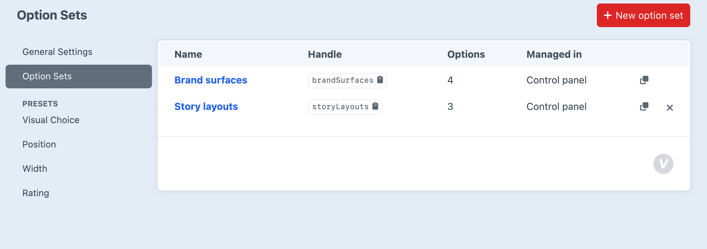
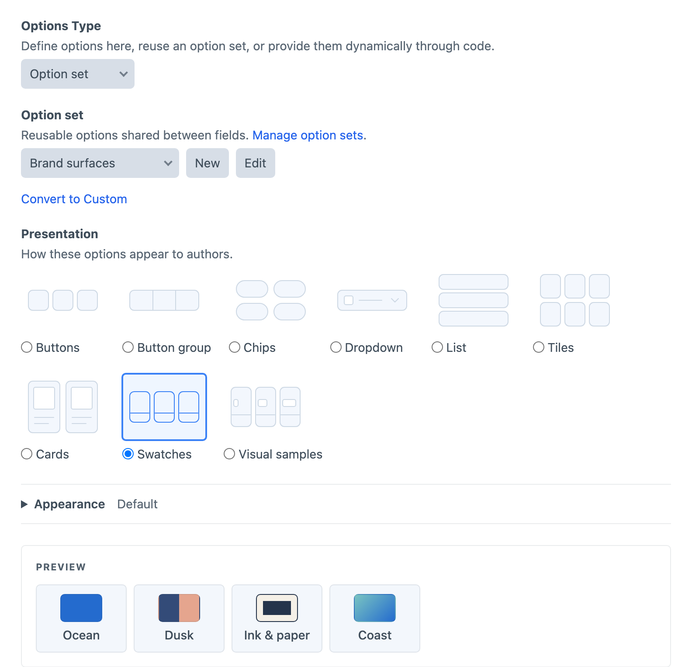

# Option Sets

Option sets let Visual Choice and Visual Multi-Choice fields share the same choices. Editing a set updates its options everywhere it is referenced, while each field keeps its own presentation and appearance. Use an option set for a shared list such as editorial intent, brand colours or content treatments. Use a [preset](presets.md) when each field should receive an independent starting point instead.

## Creating and Using Sets

Manage reusable option sets under **Settings → Plugins → Button Box → Option Sets**. Choose **New option set**, enter a name and handle, and use the [option editor](visual-choices.md#option-metadata) to define its choices. A set’s presentation and column count control its editing preview.



Save the set, then choose **Option set** in a Visual Choice or Visual Multi-Choice field’s **Options Type** setting and select it by name. Save the field and check its choices on an entry. The entry stores only the selected option values, so keep those values stable when changing labels or visuals.

You can also use **New** and **Edit** beside a field’s option-set selector. These open a slide-out; saving selects the set and refreshes the field preview without saving the field itself. Changes to the set affect every referencing field.



## Making an Independent Copy

Choose **Convert to Custom** beneath a field’s option-set selector to copy the set’s current choices into that field. Its presentation and appearance are preserved. Save the field to end the reference; subsequent changes to the shared set will not affect its Custom options.

## Managing Sets

Sets created in the control panel are stored in Craft’s project config and referenced by stable IDs. Renaming a set or its handle preserves field references. Managing sets requires an administrator and `allowAdminChanges`.

Use the duplicate icon to open an independent copy with a new handle, then save it to create the new set. Config-defined sets can also be copied into a set managed in the control panel.

The delete icon is available for unused sets created in the control panel. A set cannot be deleted while a field uses it. Choose another set or **Convert to Custom** on each referencing field and save those fields first.

## Config-Defined Sets

You can also define option sets in `/config/buttonbox.php`. This file is optional. Config-defined sets appear alongside CP-managed sets but are edited in the file, and CP-managed sets cannot reuse their handles.

Create `/config/buttonbox.php` and add only the named sets the project needs:

```php
<?php

return [
    'optionSets' => [
        'editorialIntent' => [
            'label' => 'Editorial intent',
            'options' => [
                ['label' => 'Standard', 'value' => 'standard', 'color' => '#64748b'],
                ['label' => 'Feature', 'value' => 'feature', 'color' => '#2563eb'],
                ['label' => 'Campaign', 'value' => 'campaign', 'color' => '#db2777'],
            ],
        ],
    ],
];
```

Choose **Option set** in a Visual Choice or Visual Multi-Choice field’s **Options Type** setting, then select the set by label. Config-defined sets are referenced by their handles.
