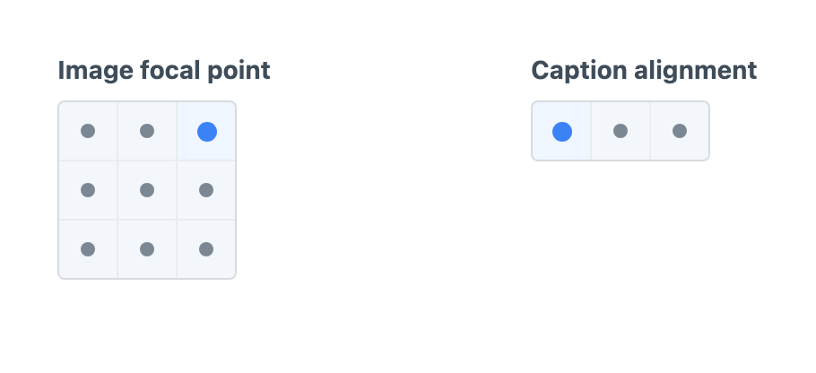
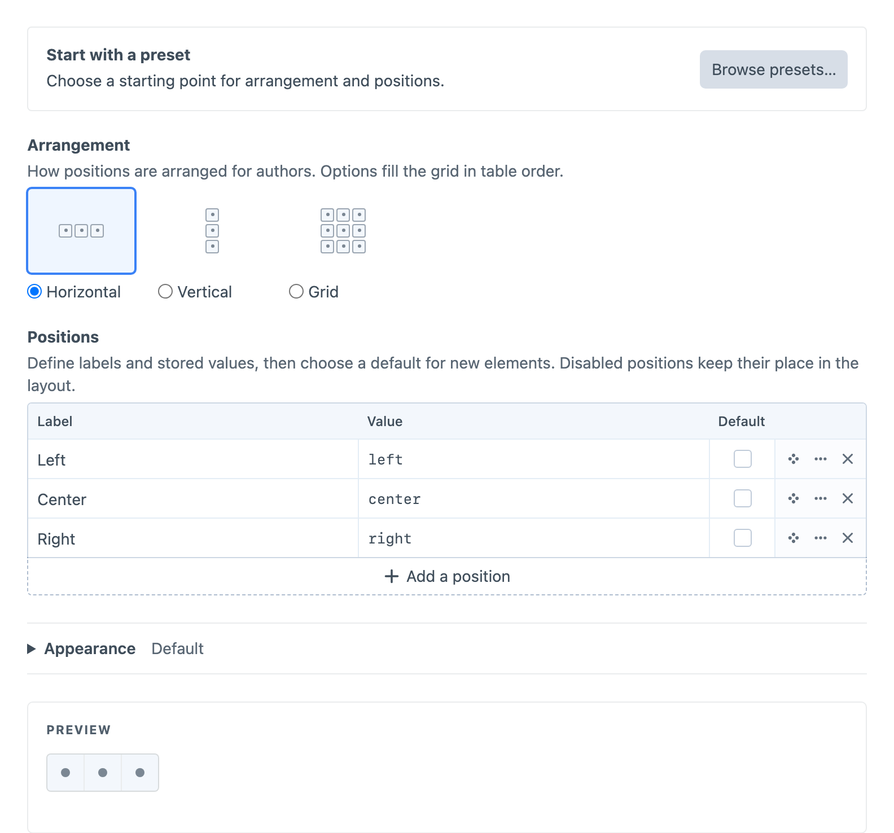

# Position

Position presents choices spatially: in a horizontal row, vertical column or grid. Use it for alignment, focal points and project-specific arrangements where the position of each choice helps authors recognise it.



Create a **Button Box - Position** field under **Settings → Fields**, then add it to the field layouts that need it.

## Configuring Positions

Start with **Horizontal alignment**, **Vertical alignment**, **Focal point** or **Four corners** in the [preset chooser](presets.md). A preset copies its arrangement and options into the field; you can then edit them independently. Choosing another preset replaces those unsaved settings.

The Positions table contains each option’s **Label**, stored **Value** and optional **Default**. Add, delete or reorder rows to change the arrangement. Grid options fill each row in table order, with 1–12 configurable columns and enough rows to fit the options. For example, add an “Inset left” option with the value `inset-left` between Left and Center to create a four-choice horizontal alignment field.

Open **Edit option…** in a row’s menu to disable a position and optionally explain why it is unavailable. A disabled position keeps its cell but cannot be selected. Disabling the default clears it; choosing a disabled position as the default enables it. At least one position must remain enabled. The live preview shows the resulting author input; selecting a position there does not change the field’s default or options.

Defaults apply to new elements. Existing empty values stay empty, and stored values that are removed or disabled remain visible as unavailable rather than being replaced automatically. When the field is optional, authors clear a selected or unavailable position by choosing it again or pressing Delete on it. **Show clear button** in Appearance adds a clear button beside the control.



## Appearance

**Show tooltips**, in the **Appearance** table, controls whether position labels and unavailable reasons appear on hover or keyboard focus. It is enabled by default, and changes are reflected in the live preview. Accessible labels remain available when tooltips are off.

The **Appearance** table controls **Size**, **Background**, **Dot colour** and **Selection colour**. Size scales the cells and dots together. Dot colour sets the unselected dots; Selection colour sets the selected dot and a subtle cell tint. Leave colour overrides empty, or use **Reset**, to restore the defaults. Appearance changes update the live preview.

## Using the Value

Twig receives a typed object containing the stored identity, label, validity and arrangement metadata. Standard named positions also provide alignment coordinates; custom identities use your own template mapping. See the [PositionData reference](../reference/position-data.md) for types, coordinate meanings and null handling.

For a Position field with handle `focalPoint`, use this in the entry’s Twig template:

```twig



    <div data-position="{{ focalPoint.value }}" style="--focal-x: {{ focalPoint.x }}; --focal-y: {{ focalPoint.y }}">
        {{ entry.title }}
    </div>

```
