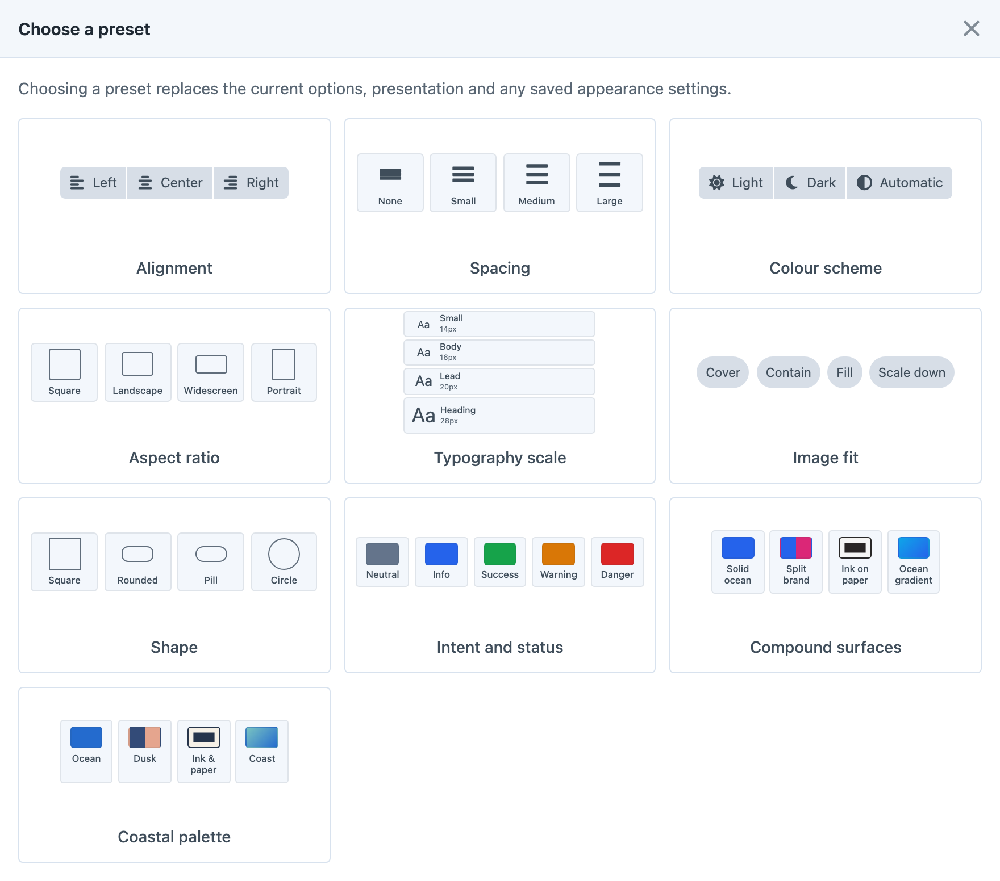
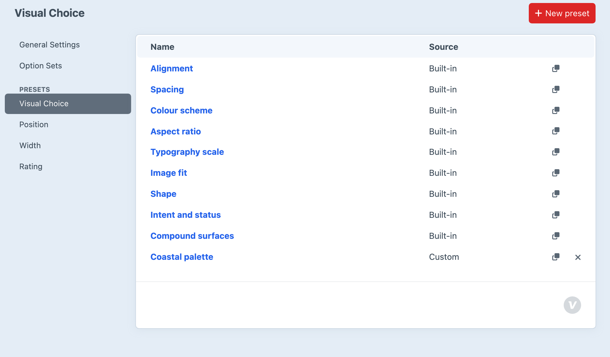

# Presets

Presets provide reusable starting points for Visual Choice, Visual Multi-Choice, Position, Width and Rating fields. Applying a preset copies its settings into the field, where you can adjust them independently. Later changes to the preset do not change fields that already used it. Use an [option set](option-sets.md) when several fields should share a list that updates in one place.

## Applying a Preset

Choose **Browse presets…** in the field settings and select a preset. The choices and preview update immediately. Applying another preset replaces the relevant unsaved settings, so review the result before saving the field. Presets do not change the defaults used when creating other fields.

Visual Choice and Visual Multi-Choice presets copy options, presentation and saved appearance settings. Dropdown presets are available only for Visual Choice.

Position presets copy options, arrangement, grid columns, tooltips and saved appearance settings. Width presets copy percentage stops, display style, labels, tooltips and saved appearance settings.

Rating presets copy the symbol and active/inactive colours. The maximum, default, numeric-label and clear-button settings are preserved.

For visual choices, Position and Width, built-in presets without saved appearance settings leave the field’s existing appearance overrides in place. Customised and user-created presets copy their saved appearance settings.

## Creating a Preset

Under **Settings → Plugins → Button Box**, the **Presets** sidebar heading groups separate **Visual Choice**, **Position**, **Width** and **Rating** pages. The Visual Choice page manages presets for both Visual Choice and Visual Multi-Choice. Open the relevant page and choose **New preset**, or use the duplicate icon beside an existing preset. Give it a name, edit its settings and save. Use the live preview to check its appearance.

For example, duplicate **Stars**, name it “Brand stars”, and choose your active and inactive colours. Save it, open a Rating field and select **Brand stars** from **Browse presets…**. Check the preview, then save the field to retain the copied symbol and colours.

## Customising and Restoring Presets

Open a built-in preset to customise it for the project. **Restore original** removes that customisation and returns to the shipped preset. Use the delete icon in a preset table to delete a custom preset, or delete it from its editor. Built-in presets cannot be deleted.

These changes affect presets available for future use. Fields that have already used a preset keep their copied settings and stored content.

Managing presets requires an administrator and `allowAdminChanges`. Custom presets and built-in customisations are stored in Craft’s project config, so they can be deployed with the project.
