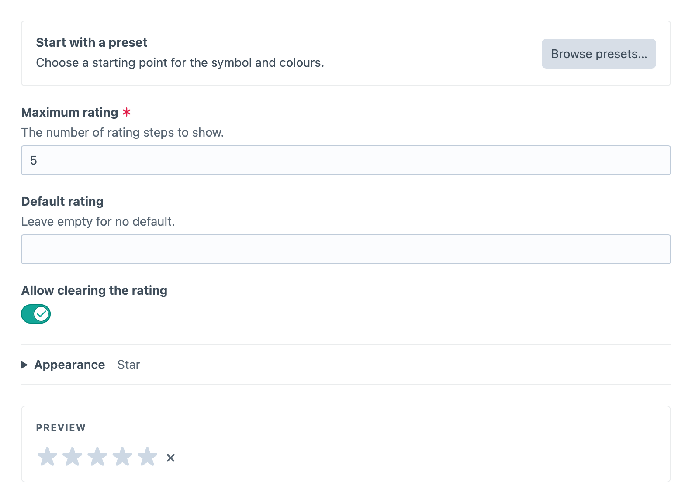

# Rating

Rating gives authors a whole-number scale for scores, recommendations or reviews. Create a **Button Box - Rating** field under **Settings → Fields**, then add it to the field layouts that need it.


## Configuring Ratings

Rating stores a whole integer from 1 to the configured maximum, which can be between 2 and 20 and defaults to 5. An unset or cleared field stores `null`, not zero. An optional rating clears when authors choose its current value again or press Delete on it; turn on **Show clear button** in Appearance to also show a clear button. Configure the maximum, an optional default, a star, heart, circle or diamond symbol, active and inactive colours, and optional visible numeric labels. Every step retains an accessible numeric name regardless of its visible symbol.

Fractional ratings are not supported. Use another field when halves or arbitrary decimals are part of the content model.



## Presets and Appearance

Choose **Stars**, **Hearts**, **Circles** or **Diamonds** from [**Browse presets…**](presets.md) for yellow stars, pink hearts, blue circles or purple diamonds. Choosing a preset copies its symbol and colours into the field immediately, preserving the maximum, default, clearing behaviour and numeric-label setting. You can then customise the copied settings in **Appearance**.

**Appearance** contains the symbol, active and inactive colours, and **Show numeric labels**. Its collapsed summary describes the current appearance. The live preview remains visible beneath it and updates as you edit; choosing a rating in the preview does not change the field’s default.

## Using the Value

For a Rating field with handle `editorialRating` and a maximum of five, use this in the entry’s Twig template. Replace five with your configured maximum:

```twig

    <p>Editorial rating: {{ entry.editorialRating }} / 5</p>

```
