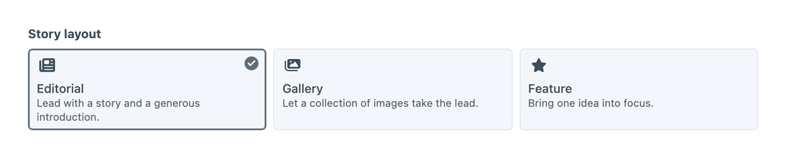
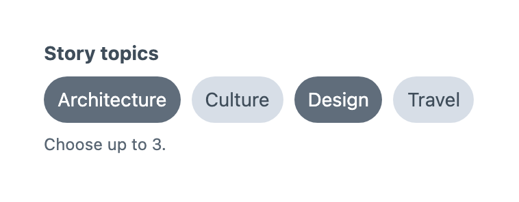
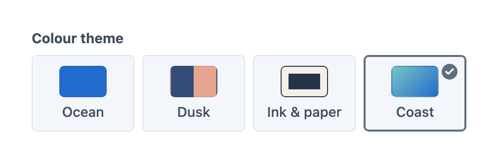
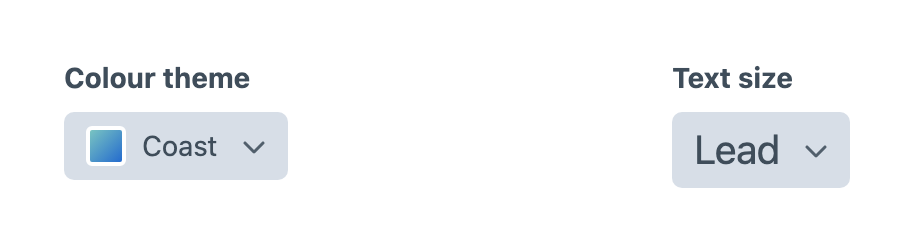
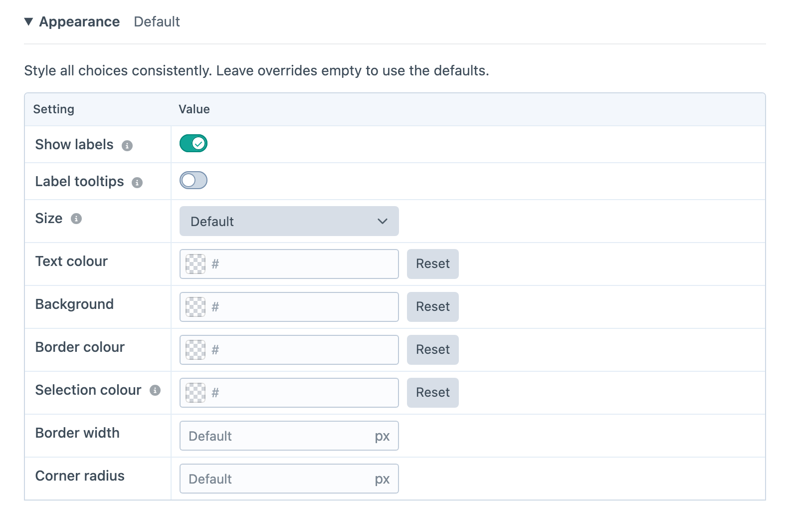
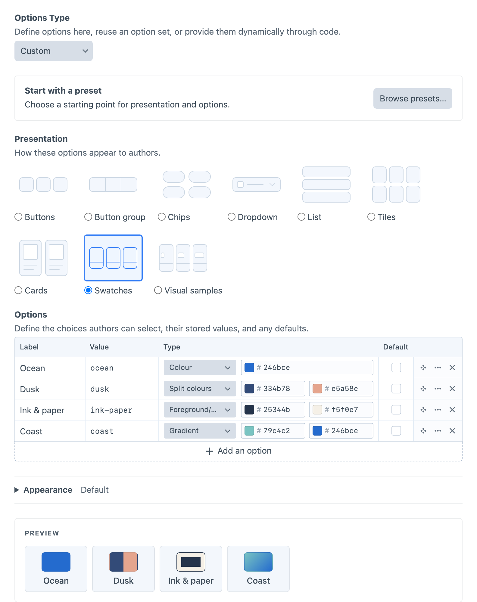

# Visual Choices

Visual Choice stores one approved value and Visual Multi-Choice stores a selected set. Both fields share option metadata and most control-panel presentations, so the decision can become richer without changing the identity your templates consume.

## Choosing a Field

Use Visual Choice for one stored identity and Visual Multi-Choice for several. Choose Position when the geometry carries meaning, Width for percentage stops, and Rating for a whole-number scale. Craft's native Button Group, Checkboxes, Radio Buttons or Dropdown fields are suitable when ordinary labels, icons and colours already communicate the choice. Button Box adds images, descriptions, compound surfaces, reusable sets and visual presentations for decisions that benefit from them.

## Selection Settings

**Default** supplies the starting selection on a new element. Visual Choice permits one default; Visual Multi-Choice permits several. Changing a default does not replace an existing stored selection. Mark the field as required in its entry-type layout when authors must choose a value. On an optional Visual Choice, authors clear the selection by choosing the selected option again, or by pressing Space or Delete on it. Turn on **Show clear button** in Appearance to also show a clear button, beside compact presentations or beneath List, Tiles and Cards. Dropdown uses its **None** option instead.

Visual Multi-Choice adds **Minimum selections** and **Maximum selections** below the shared settings. The minimum defaults to zero; an empty maximum means no upper limit. A minimum of two requires two selections even if the layout does not mark the field as required. A required placement still rejects an empty selection when the minimum is zero. Choose a maximum at least as large as the minimum, and keep defaults within the same limits. For example, minimum 1 and maximum 3 lets authors choose up to three approved features. The input preserves choices for validation rather than silently trimming excess selections. When limits are set, the input states them beneath the choices.

Selected values are a set of stable identities. Do not use click order as a ranking: saved configured values follow option order. Removed stored identities remain available for diagnostics and fail ordinary validation.

## Presentations

Choose a presentation to suit the option labels and visuals:

- **Buttons** show separate rounded controls with an 8px gap.
- **Button group** joins the controls into compact segments.
- **Chips** suit short tags and multi-choice sets.
- **Dropdown** keeps a single selection in a compact control, with colour swatches, icons or images beside the label and typography options displayed at their configured size. It is available for Visual Choice.
- **List** gives labels and descriptions room to explain a decision.
- **Tiles** arrange visual options in a responsive grid.
- **Cards** combine images or icons with descriptive copy.
- **Swatches** show colours and compound surfaces such as gradients.
- **Visual samples** give each width, aspect ratio, typography size or shape an equal-sized preview area with its label underneath. Width bars use a common scale so their proportions can be compared directly.

The **Buttons**, **Button group** and **Chips** presentations use neutral controls with a solid selected state. Cards, Tiles, List, Swatches and Visual samples keep a light background and mark selection with a stronger neutral border and a checkmark. A separate blue ring identifies keyboard focus. Icons follow the text colour; artwork and swatch colours retain their own values.

For a compact colour selector, add options with the Colour type and choose **Dropdown**. The selected swatch stays visible when the menu closes. For text sizes, apply the **Typography scale** preset and then change Presentation to **Dropdown**; both the options and the selected label preview their configured sizes. Open the menu with the keyboard, use the arrow keys or type a label to find an option, and select **None** to clear it. A required field still needs a selection before the entry can be saved. Disabled options show their unavailable reason, and removed selections remain visible until you choose another value.

Dropdown always shows labels and uses compact artwork that fits inside the control. Label visibility, label tooltips and image sizing settings are hidden for this presentation; their values are retained when switching to another presentation. Size, colours, border and corner-radius overrides remain available.

### Appearance

**Appearance** starts collapsed, with a summary of active customisations and a live preview beneath it. Expand it to adjust the controls.

Use **Show labels** in the **Appearance** table to hide option labels when icons, images or swatches communicate the choice. Keep a Label for each option: it supplies the screen-reader name and optional tooltip. Options without a visual always display their label, and descriptions remain visible when supplied. **Label tooltips** is off by default. Turn it on to show option labels on hover and keyboard focus, whether the labels are visible or hidden; unavailable reasons still appear for disabled options independently of label tooltips.

For every presentation, Appearance also provides shared size, text colour, background, border colour and width, corner radius, and selection colour controls. Size changes text, icons and spacing together. Leave colour, border width and radius overrides empty to keep the defaults; **Reset** clears a custom colour. Selection colour controls the border and checkmark on outlined choices, and the border and subtle background tint on buttons and chips. Keyboard focus remains separately visible.

When options include images, Appearance also offers **Image size** and **Image fit**. Automatic sizing follows the presentation; Fit shows the complete image and Fill crops it. Image settings apply to all options, keeping choices consistent. Appearance affects the Craft control panel only and does not add frontend styles.

Use the dedicated [Width field](width.md) for cumulative widths, percentage stops and width presets. Width artwork remains available in Visual samples when it belongs to a general option set. Aspect-ratio samples fit inside a bounded area while preserving their proportions, so tall or wide samples do not stretch the choices.

## Option Metadata

Every option has a `label` and stable `value`. Add only the metadata that helps authors make the decision. The types below describe option definitions supplied through PHP; optional keys may be omitted.

| Property | Type | Description |
| --- | --- | --- |
| `label` | `string` | Required display label and accessible name. |
| `value` | `string` | Required stable identity stored in content. |
| `description` | `string` | Supporting copy for the choice. |
| `icon` | `string` | Craft, custom-gallery or bundled icon identifier. |
| `color` | `string` | Simple colour cue. |
| `imageUrl` | `string` | Image preview URL. |
| `imageAlt` | `string` | Image alternative text. |
| `surface` | `array` | Structured visual definition. |
| `category` | `string` | Metadata for templates and integrations. |
| `disabled` | `bool` | Prevents selection. |
| `explanation` | `string` | Unavailable reason for a disabled option. |
| `default` | `bool` | Selects the option initially on new elements. |

Image URLs support environment variables and Craft aliases such as `@web`. Category metadata has no field-settings control and does not group choices in the input.

Disabled choices retain their rows and metadata. A stored disabled choice remains visible and fails entry validation until corrected. Its **Unavailable reason** appears beside Dropdown options or in tooltips for other presentations, independently of image alternative text.

Field settings use an editable table for labels, stored values, visuals and default selections. Choose a **Type**, then use its inline control to browse icons or images, pick colours, enter dimensions or choose a shape. Use **Choose asset…** to search Craft’s asset library. Configured gallery files use portable references; asset and external images use URLs. Moving a file or changing an asset URL requires updating the option.

Drag the row handle to reorder options, or use the row menu to move or insert rows. Each row has a delete control. Choose **Edit option…** from the row menu for descriptions, visual details and availability. The dialog shows controls for the selected type, such as image alternative text, gradient or split directions, and custom shape dimensions. Direction choices include arrows and a custom angle; foreground/background options offer **Swap colours**. Changing presentation preserves these details. Use the live preview to check the result.

See [Option Data](../developers/option-data.md) for PHP definitions and surface bounds, and [Visual Option](../reference/visual-option.md) for the properties returned to templates.

## Option Sources

Choose **Custom** to edit options within the field, **Option set** to reference [reusable options](option-sets.md), or **Dynamic (PHP)** to supply options through a [PHP provider](../developers/custom-option-providers.md). An option set shares its choices across fields while each field keeps its own presentation and appearance. Choose **Convert to Custom** beneath the selector when a field needs an independent copy.

Choose **Browse presets…** in the **Start with a preset** panel above Presentation to browse visual starting points for both presentation and options. Selecting a preset immediately copies its options and presentation into the editor and closes the chooser. Changes are only stored when you save the field or option set. Create and customise your own [presets](presets.md). Saved presets also copy their appearance settings. Applying one leaves the field with an independent copy.

**Spacing** provides None, Small, Medium and Large, illustrated with progressively separated bars. Its values are `none`, `small`, `medium` and `large`; map them to your project’s padding or gap scale. The illustrations do not impose pixel dimensions.

**Colour scheme** provides Light, Dark and Automatic, with sun, moon and half-circle icons. Its values are `light`, `dark` and `auto`; your templates decide how Automatic follows the site theme or visitor preference.

Only option identities are stored in content. Changing a label, description or visual cue updates authoring metadata without rewriting entries.

If a stored identity disappears from its Custom, Option set or Dynamic source, the field keeps that identity visible as unavailable and fails validation instead of silently selecting a default.

## Craft Integration

Stored visual fields participate in element previews, cards, search, option conditions, sorting and inline editing. Query Visual Choice by its stored identity and Visual Multi-Choice by membership. See [Querying Entries](../template-guides/querying-entries.md) for contains-any/contains-all examples, empty selections, numeric Rating queries and the sorting differences between field types.
