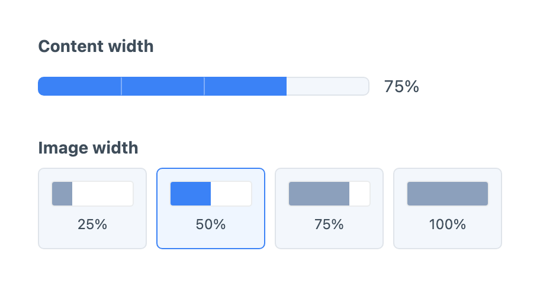
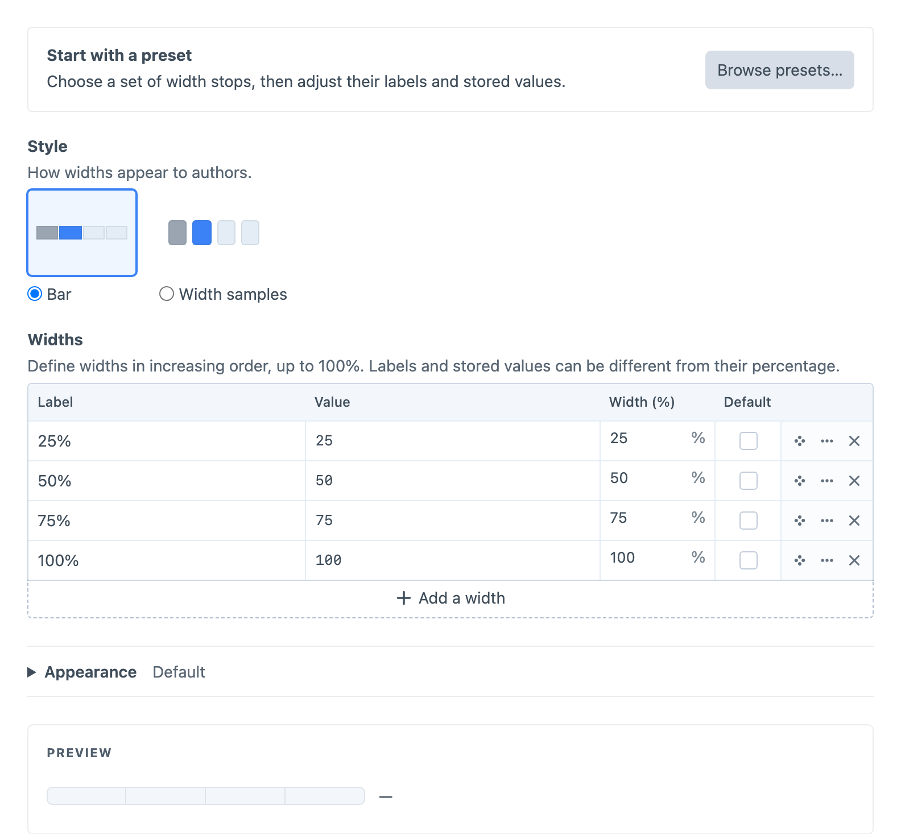

# Width

Width offers a constrained set of layout widths, shown as a slim cumulative **Bar** or separate **Width samples**. The bar fills blue through the selected width, leaving the remainder light blue-grey. Width samples use blue-grey fills and a blue selection, matching Position's control-panel palette.



Create a **Button Box - Width** field under **Settings → Fields**, then add it to the field layouts that need it.

## Configuring Widths

Choose **Halves**, **Thirds**, **Quarters** or **Grid columns** from [**Browse presets…**](presets.md). Shipped presets copy their width stops and style into the field, preserving Appearance settings. Customised and user-created presets also copy their saved appearance. Grid columns provides twelve stops with values `1` through `12`; the other presets use percentage values. Edit the **Label**, stored **Value**, **Width (%)** and optional **Default** in the Widths table. Percentages must increase in table order, above 0 and up to 100. A stored value such as `wide` can represent 75%; templates decide what that identity means on the frontend.

Open a row's **Edit option…** menu to disable a width and add an unavailable reason. Disabled stops keep their place. Defaults apply to new elements; removed or disabled stored values remain visible as unavailable until another width is selected. The preview changes no defaults or stored content.



## Appearance

In **Appearance**, **Labels** can show the selected value beside the control, show every option, or hide visible labels. **Show tooltips** independently controls labels and unavailable reasons on hover and keyboard focus. Accessible names remain available in all modes. Adjust size, text colour, background, fill colour, selection colour, border and corner radius, or leave overrides empty for the defaults.

## Using the Value

Width uses the `WidthChoice` PHP class and exposes scalar content and GraphQL output. Twig receives a [WidthData](../developers/width-data.md) object with the stored identity, label, percentage and availability metadata; printing it returns the stored value. The configured percentage describes the control-panel geometry and does not inject public CSS.

For a Width field with handle `layoutWidth`, use this in the entry’s Twig template:

```twig

    <div data-width="{{ entry.layoutWidth.value }}">{{ entry.title }}</div>

```
