<!-- feature-intro -->
Give authors clear, visual choices instead of a list of internal names to memorise. Button Box turns your approved values into buttons, cards, swatches, position grids, width bars and ratings in the control panel, while your templates receive the same stable values every time.
<!-- feature-intro-end -->

<!-- feature-section media-size="large" media-shadow="false" -->
## Make the right choice obvious

Present a set of approved values as buttons, button groups, chips, dropdowns, lists, tiles, cards, swatches or visual samples. Add a short description, an icon, an image or a colour so authors recognise each choice at a glance instead of trying to remember what `layout-b` means.

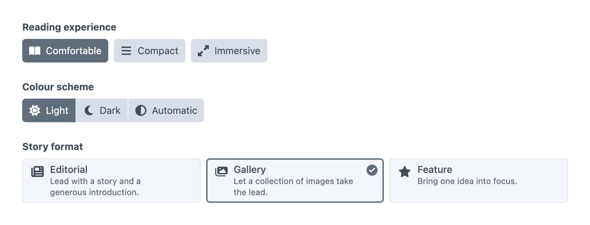
<!-- feature-section-end -->

<!-- feature-cards -->
## A field for every kind of choice

Each one shows authors what they’re choosing and hands your templates a value they can rely on.

### Draw ratios, corners and spacing in the field

Some choices are far easier to see than describe. Visual samples draw aspect ratios, corner styles, spacing and type sizes right in the field, so authors can tell Widescreen from Landscape, or Pill from Rounded, before they pick one.

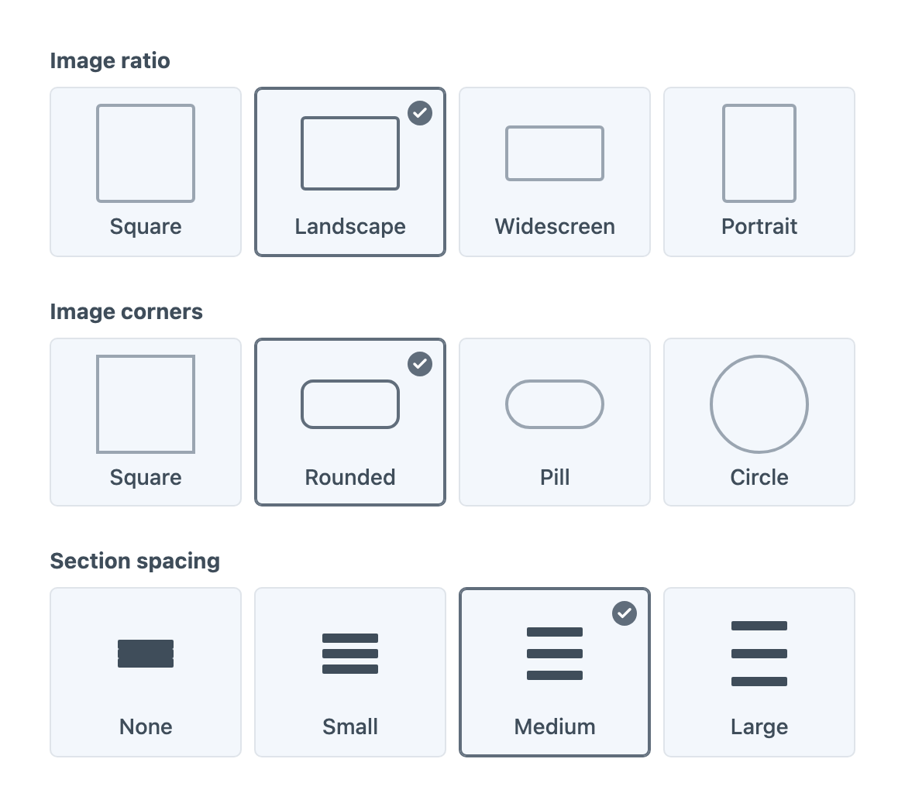

### Let authors see the palette

“Coast” means more when authors can see the colours. Present solid colours, split swatches, text and background pairs, or gradients as choices people recognise. Your templates get the selected value along with the colours behind it, so the front end can use them too.

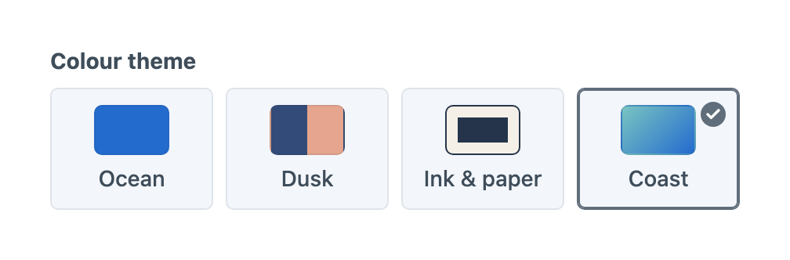

### Pick a few, within limits

Visual Multi-Choice lets authors select several options at once, such as topics, content features or audiences, using chips, buttons, cards and the other presentations. Set a minimum and maximum so every story gets at least one topic and no more than three, and the field shows that limit right where authors are choosing.

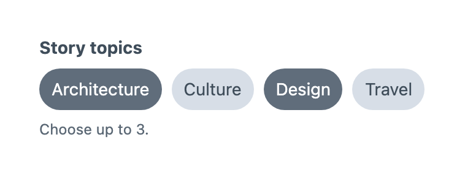

### Point to where things go

Asking an author to pick “top right” from a dropdown relies on them picturing it. A Position field lets them click the spot instead, laid out as a row, a column or a grid. Use it for image focal points, caption alignment, overlay placement or any arrangement your design needs, and use the coordinates that come with standard positions to turn the choice into CSS.

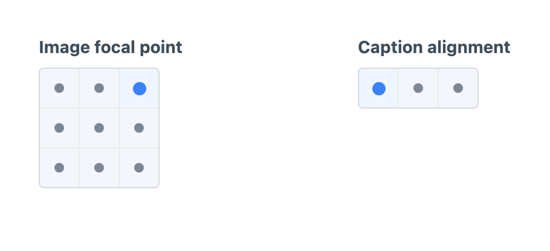

### Choose widths by sight

Offer a fixed set of widths as a single bar or as separate samples, so authors can see how much room a block will take before they choose. Start from halves, thirds, quarters or twelve grid columns, then store whatever value your stylesheet expects, whether that’s `75`, `wide` or `9`.

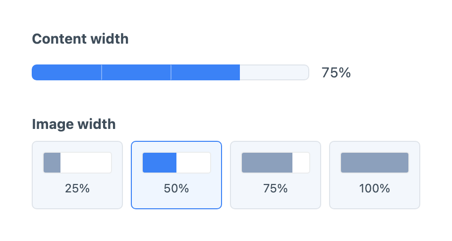

### Ratings that mean what they say

Give reviews, recommendations and editorial scores a familiar scale of stars, hearts, circles or diamonds, with anywhere from 2 to 20 steps. An entry that hasn’t been rated stays empty rather than quietly becoming zero, so your templates can tell “not rated yet” apart from a low score.

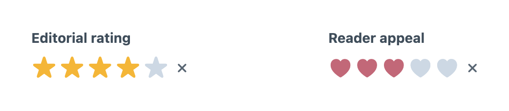

### Add shortcut buttons to the entry editor

Give editors a one-click route to what they need while they work, such as a preview of the story, the brand guidelines or a related report. Links can include details from the entry they appear on, so one shared field can send every entry to its own preview page. Set up the buttons once with labels, icons and styles, add them to any field layout, and show them only to the people and entries that need them.

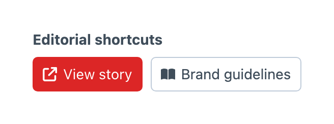
<!-- feature-cards-end -->

<!-- feature-section -->
## Field settings, option sets and presets
<!-- feature-section-end -->

<!-- feature-media copy-position="sticky" media-shadow="false" -->
## See it before you save

Every field’s settings include a live preview of exactly what authors will see. Switch between buttons, cards, swatches and the other presentations, add each option’s colours, icons or images in one table, and adjust size, colours, borders and corners until it looks right.

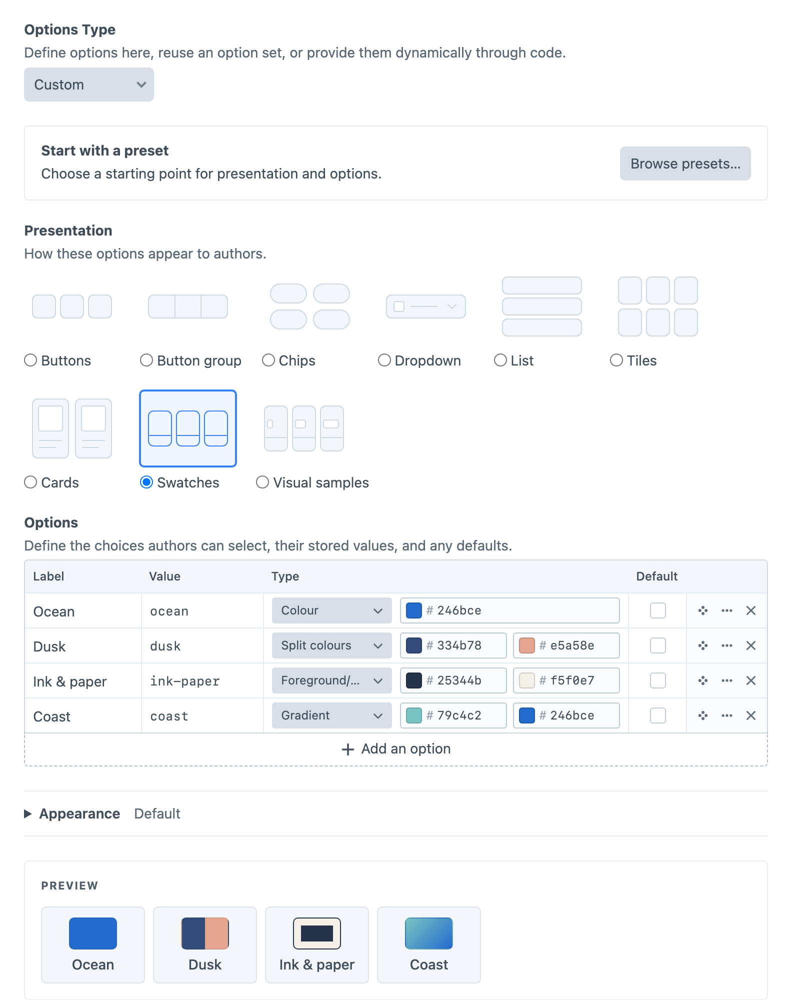
<!-- feature-media-end -->

<!-- feature-media copy-position="sticky" media-shadow="false" -->
## Set the choices once, use them where they belong

A brand palette or set of card styles should look the same in every field that uses it. Save it as an option set, edit it from any field that uses it, and deploy it with project config alongside the rest of your schema. When one field needs to go its own way, convert it to its own copy of the options.

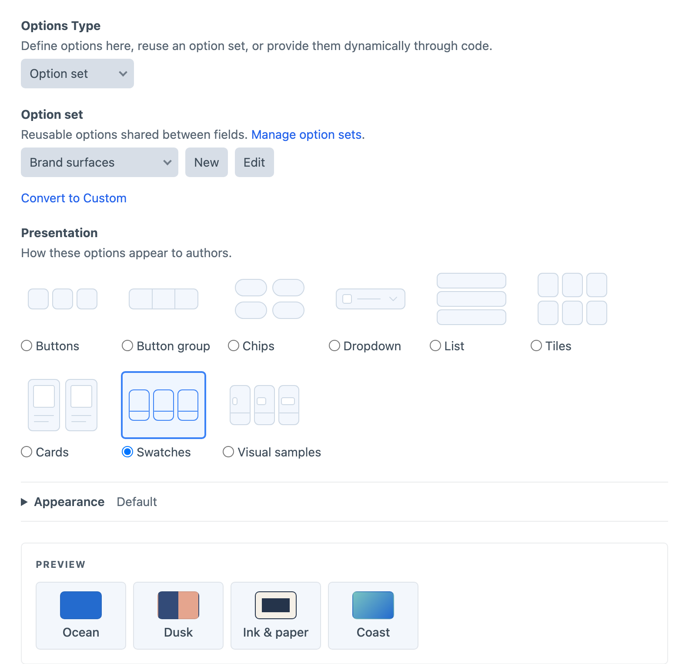
<!-- feature-media-end -->

<!-- feature-media copy-position="sticky" -->
## Start with a preset, make it your own

Begin with an alignment picker, a typography scale, a set of shape samples or one of the other built-in presets, then adjust the choices and appearance to suit your project. Save your own presets for the setups you use again and again. Applying a preset copies its settings into the field, so changing the preset later won’t touch fields you’ve already set up.

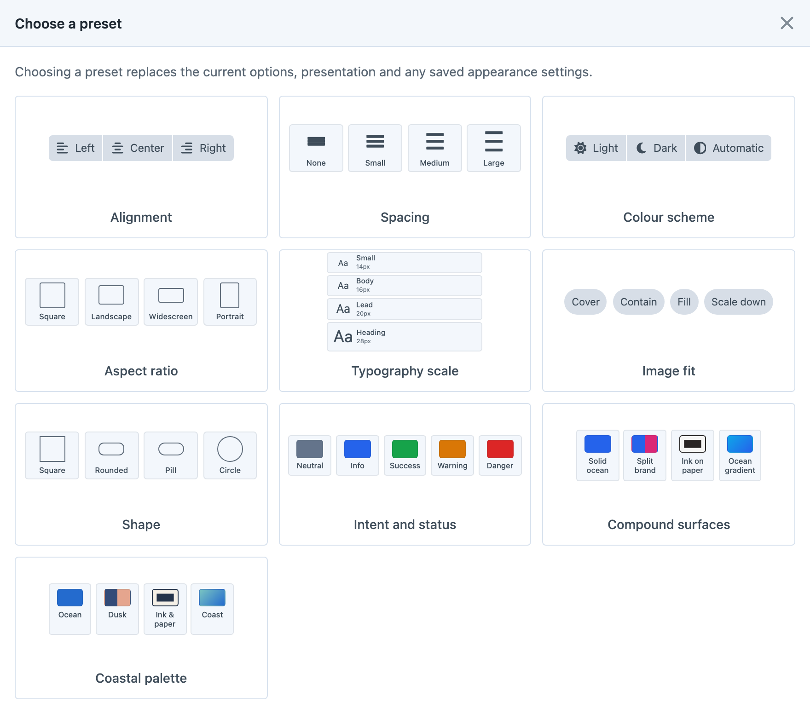
<!-- feature-media-end -->

<!-- feature-grid -->
- :icon[list-search] **Find entries by their choices** Show selections in entry indexes and cards, then search, filter and sort by them or change them inline without opening each entry.
- :icon[ban] **Retire options gracefully** Disable an option and explain why it’s unavailable. It keeps its place, and entries still using it are asked to choose again rather than quietly switching to something else.
- :icon[code] **Choices from your own code** When the options come from your application, such as a list of regions or publishing channels, supply them with PHP instead of maintaining them by hand.
- :icon[photo] **Your own icons and images** Browse the built-in icon library, pick images from your asset volumes, or add folders of your own icons and images to the galleries.
- :icon[brackets-angle] **Front-end output stays in your hands** Button Box only styles the control panel. Twig and GraphQL give you the selected values plus details like colours and coordinates, and you decide what they become on your site.
<!-- feature-grid-end -->
